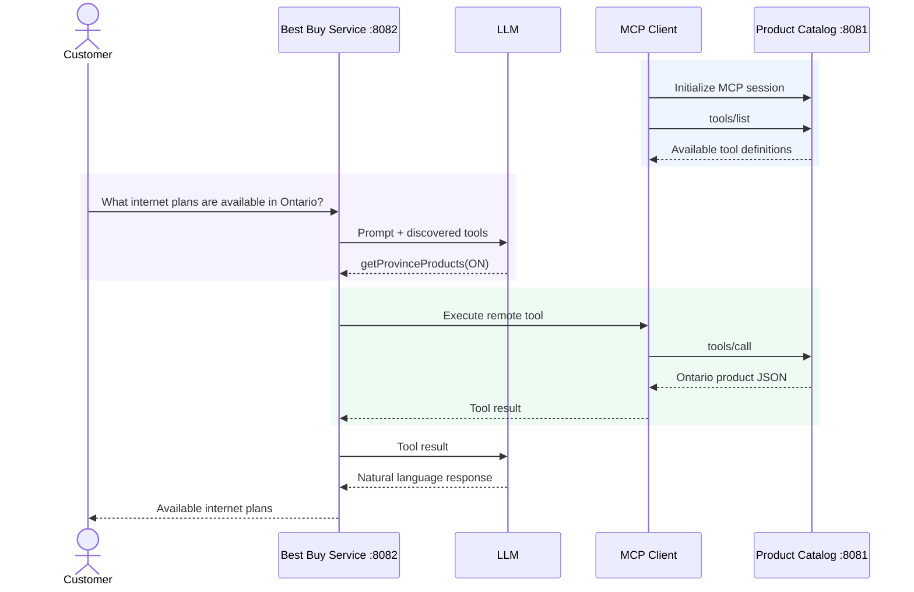

# Best Buy Service

A separate Spring Boot chat service that connects to the product catalog's MCP server over SSE and makes its tools available to the chat model. Requires Java 17+, Maven, an OpenAI API key, and the product catalog service and its PostgreSQL prerequisites.

Start the product catalog service first (see its README), then in another terminal:

```sh
cd bestbuy-service
export OPENAI_API_KEY='your-api-key'
mvn spring-boot:run
```

Send a chat request:

```sh
curl -X POST http://localhost:8082/bestbuy/chat \
  -H 'Content-Type: application/json' \
  -d '{"prompt":"What internet plans are available in Ontario?"}'
```

The response is `{"response":"..."}`. A missing or blank prompt returns HTTP 400; a model or tool failure returns HTTP 502. The model decides when to call a tool. Each request is independent and no conversation history is stored. Catalog data and cart orders are examples; no order is placed.

Set `PRODUCT_CATALOG_MCP_URL` to the catalog service's base URL (default `http://localhost:8081`); the MCP client connects to its `/sse` endpoint. Set `SERVER_PORT` or `OPENAI_MODEL` to override the defaults `8082` and `gpt-4.1-mini`. The MCP connection initializes at startup, so the catalog must be reachable when Best Buy starts. The catalog MCP endpoint has no authentication; use a trusted network or a secured proxy for remote connections.

## Chat and MCP sequence



Run `mvn test` from this directory. Tests use a local test MCP server and do not require an OpenAI key or a running catalog service; they require permission to bind to local ports.
